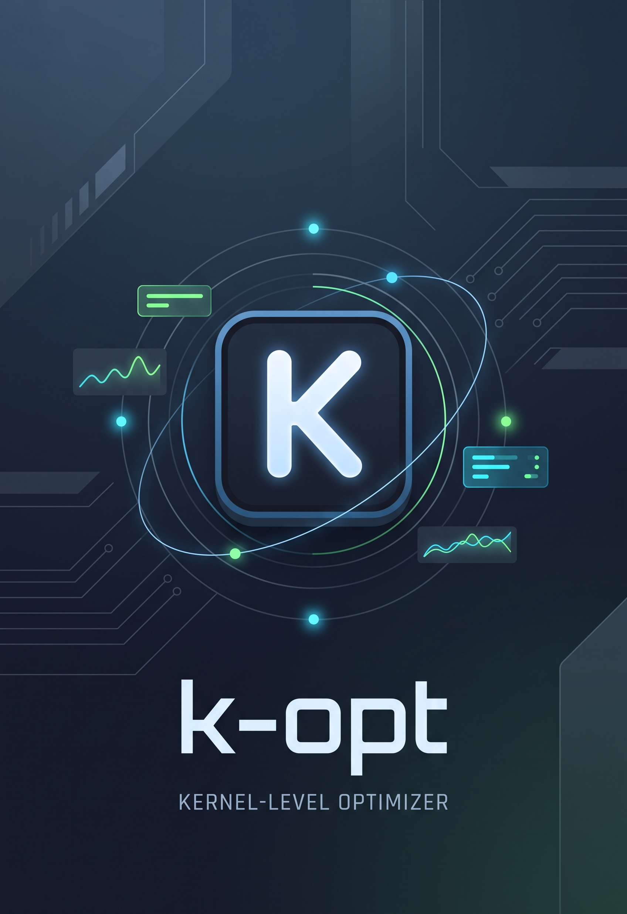

# K-OPT — Kernel & System Optimizer

-success?style=for-the-badge)

  

> **K-OPT** é um otimizador de sistema e jogos focado em estabilidade, segurança e telemetria de alta fidelidade. Projetado estritamente em **Ring 3 (Modo Usuário)**, ele gerencia afinidade de CPU e prioridades de processos em tempo real sem injeção de DLLs, sem risco de banimento por Anti-Cheat e com restauração garantida do estado original do Windows.

---

### 📌 Ajustes e Marcos do Projeto

O projeto segue um ciclo rigoroso de Engenharia de Software. Abaixo está o estado atual das entregas:

- [x] Backend local em C# (.NET Minimal API) operando em Ring 3 com fail-closed.
- [x] Trava de segurança de EULA com verificação estrita de versão (v1.0) e timestamp UTC.
- [x] Host Desktop em WPF encapsulando interface moderna via Microsoft WebView2.
- [x] Canal de IPC seguro com validação estrita de origem (`Scheme + Host + Port`) e schema JSON.
- [x] Gerenciamento automático do ciclo de vida: o host inicia e encerra o backend graciosamente.
- [x] Monitor de jogos com snapshot real de processos do Windows e restauração automática (RF04 / RF07).
- [x] Telemetria de frametime segura com fallback hierárquico: **RTSS Shared Memory ➔ ETW ➔ Indisponível**.
- [x] Otimização de HAGS com helper administrativo isolado e reversibilidade completa.
- [x] Bateria de 114 testes automatizados aprovados e validação de scripts (`node --check`).
- [ ] Implementação do **K-OPT Mobile Companion** (painel de telemetria secundário via Wi-Fi).
- [ ] Mapeamento dinâmico de perfis avançados por categoria de jogo.

---

## 💻 Pré-requisitos

Antes de instalar ou compilar o K-OPT, verifique os requisitos de ambiente:

* **Sistema Operacional:** Windows 10 (versão 1903+) ou Windows 11 — **Exclusivamente 64-bit (x64)**.
* **WebView2 Runtime:** Necessário para renderização da interface (já vem instalado por padrão na maioria dos sistemas Windows modernos).
* **RTSS (RivaTuner Statistics Server) [Opcional]:** Recomendado para leitura de *frametime* e telemetria gráfica em tempo real sem exigir privilégios de Administrador.
* **Para Desenvolvedores:** [.NET 8.0 SDK](https://dotnet.microsoft.com/) ou superior instalado na máquina.

---

## 🚀 Instalando o K-OPT

### Instalação Rápida (Recomendada para Usuários)
1. Baixe o instalador mais recente na aba [Releases](../../releases) (`KOpt-Setup-v1.0.exe`).
2. Execute o instalador. A instalação é feita no escopo do usuário em `%LOCALAPPDATA%\Programs\KOpt\`.
   * **Sem UAC/Admin:** O instalador não exige privilégios de Administrador para ser concluído (em total conformidade com a política de Menor Privilégio - RN06).
3. O atalho será criado automaticamente no Menu Iniciar e na Área de Trabalho.

### Compilação a partir do Código-Fonte (Desenvolvimento)
Clone o repositório e execute a compilação em modo Release:

# Restaurar dependências e compilar a solução
dotnet restore
dotnet build -c Release

# Executar a suíte de testes automatizados
dotnet test

# Publicar o Host Desktop completo com dependências nativas
dotnet publish KOpt.Desktop/KOpt.Desktop.csproj -c Release -r win-x64 --self-contained false

---

## ☕ Usando o K-OPT

1. **Primeira Inicialização (Consentimento EULA):**
   * Ao abrir pela primeira vez, leia o Termo de Licença e Isenção de Responsabilidade (EULA v1.0).
   * O clique em *"Aceitar e Continuar"* libera o acesso à API e grava o consentimento em `%LOCALAPPDATA%\KOpt\eula-consent.json`.
2. **Monitoramento e Otimização de Jogos:**
   * Acesse a aba **Modo Jogo**.
   * Localize o seu jogo na lista de processos ativos e clique para cadastrá-lo ou iniciar a sessão.
   * O K-OPT aplicará o perfil de afinidade de núcleos e prioridade configurado, salvando o estado original para reversão imediata ao fechar o jogo.
3. **Telemetria e Diagnóstico:**
   * Na aba **Hardware & Diagnóstico**, acompanhe o uso real de CPU, memória e estabilidade de taxa de quadros (*frame pacing*).
   * Se o RTSS não estiver aberto, o sistema indicará explicitamente o status da fonte em vez de apresentar dados simulados.

---

## 📫 Contribuindo e Reportando Problemas

O K-OPT é desenvolvido com foco em estabilidade e segurança. Para reportar falhas ou propor melhorias:

1. Acesse a aba de [Issues](../../issues) deste repositório.
2. Utilize o template de **Bug Report** detalhando a versão do Windows, especificações de CPU/GPU e logs sanitizados gerados pela aplicação.
3. Sugestões de melhorias de arquitetura ou novos testes automatizados podem ser discutidas diretamente na aba [Discussions](../../discussions).

> *Nota:* Modificações diretas ou forks para redistribuição não autorizada são restritos conforme os termos de licença do software.

---

## 📝 Licença e Direitos Autorais

Este projeto é um software proprietário distribuído como **Freeware**. 
Todos os direitos reservados. O uso é livre para fins pessoais, sendo proibida a engenharia reversa, redistribuição comercial ou comercialização de versões derivadas.

Para o texto legal completo, consulte o arquivo [LICENSE.md](LICENSE.md) ou a tela de EULA integrada no aplicativo.
